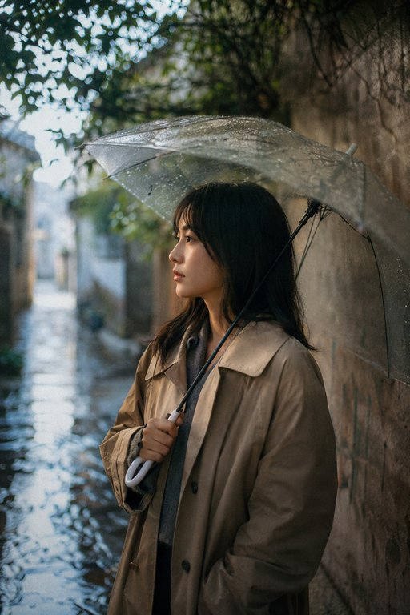
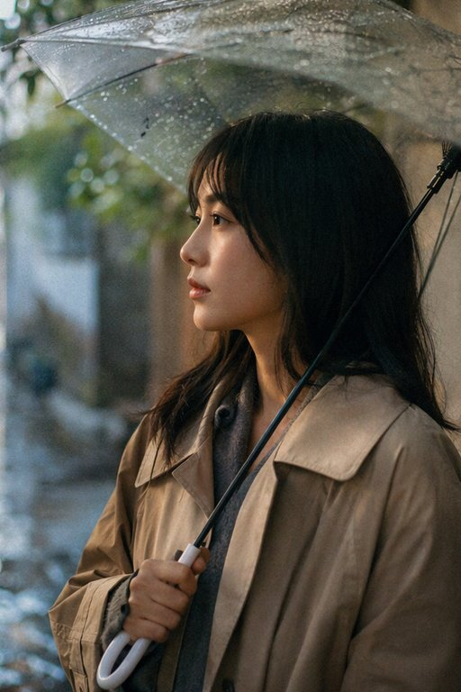
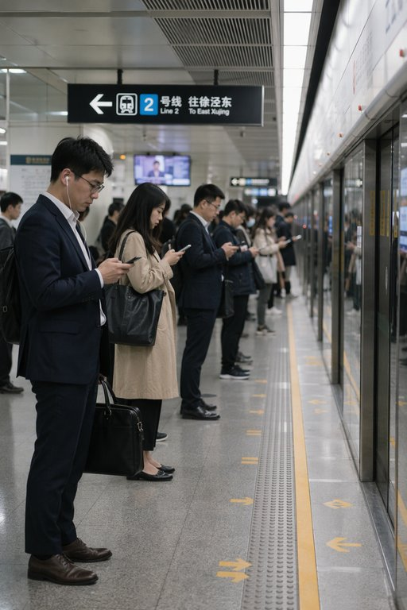
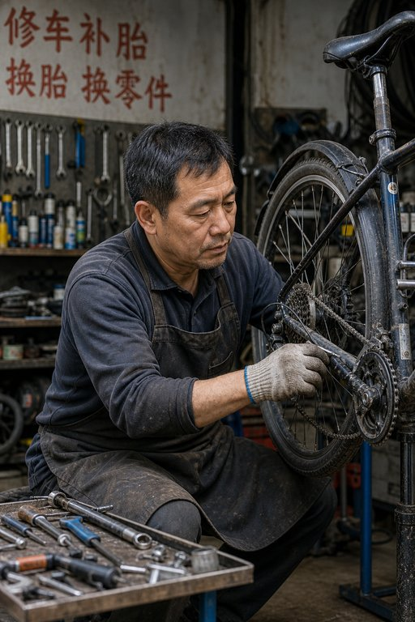
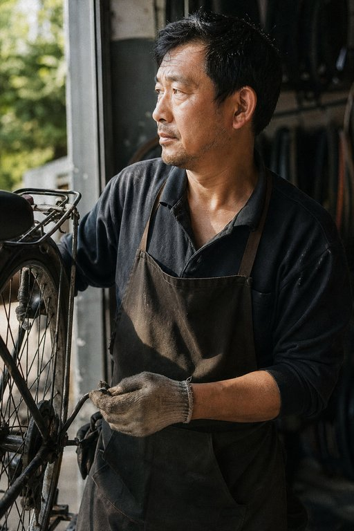
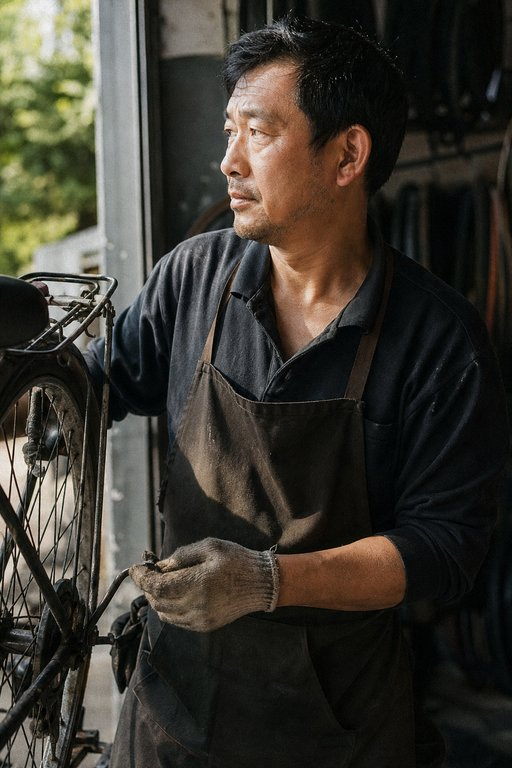
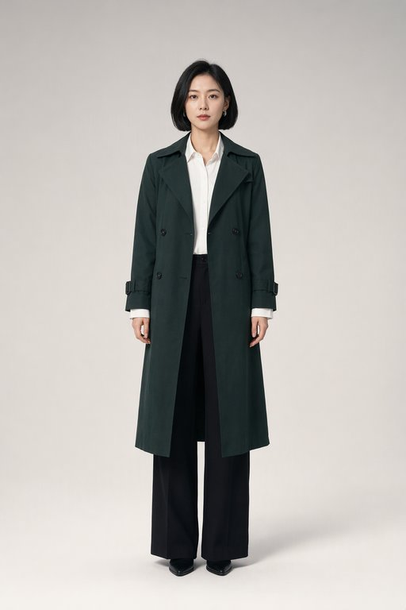
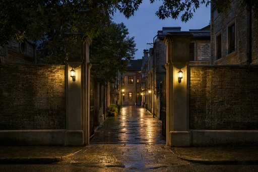
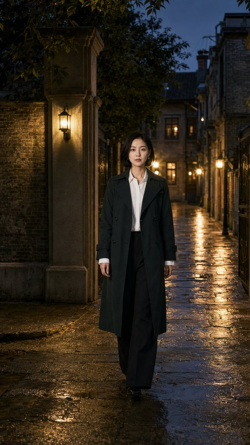
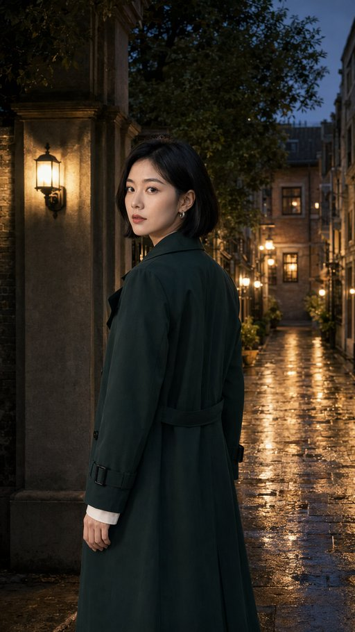

# PicSpec

**Write down how your images should look, once. Every image model follows it, and every rule gets checked.**

[中文说明](README.zh-CN.md)

You know the look you want: a little film grain, a sharp face, the subject walking left, never that plastic skin. Today you retype it into every prompt, and the model still forgets half of it. PicSpec keeps those preferences in one file, `PICSPEC.md`, as rules that can each be checked with a yes or no question. It adds them to every prompt in the way each model understands best, for commercial models (gpt-image-2) and local ones (ComfyUI) alike. No model is trained or fine-tuned.

```markdown
# My image spec

Natural-light documentary portraits with the look of 35mm film.

## Image look
- `t1` Fine film grain across the whole frame, no digital smoothness
  - check: Is an even, fine grain visible across the image?
- `t2` The face is sharp and the eyes are in focus
  - check: Are the person's eyes and face sharp, with no blur?
  - when: there is a person in the image

## Subject and composition
- `c1` The person faces or walks toward the left of the frame
  - check: Does the person face or move toward the left of the frame?
  - ref: refs/pose-left.jpg | body direction like this

## Avoid
- `f1` Over-smoothed, plastic-looking skin
  - check: Does the skin look over-smoothed or plastic?
  - expect: no
```

> **Status: v0.8, early.** Working today: the spec format, the gpt-image-2 and ComfyUI adapters (both run live), a rule library with templates, checking each rule with a vision model or a measurement, repairs in code or by editing, learning rules from feedback, an MCP server and a benchmark command. What is still open is in the [roadmap](#roadmap).

## Gallery

Real outputs from the runs below: the same prompt with no spec, with the starter spec, and after repair in code. Counts are rules met as checked by the tool.

| Prompt | Bare prompt | With spec | After repair |
| --- | --- | --- | --- |
| A woman with an umbrella in an alley after rain | <br>2 of 6 | <br>4 of 7 | <br>6 of 7 |
| A commuter waiting on a subway platform | <br>1 of 7 | <br>4 of 7 | <br>6 of 7 |
| A middle-aged man repairing a bicycle | <br>2 of 7 | <br>5 of 7 | <br>6 of 7 |

A short drama: a character sheet and a setting, then two keyframes that use both as references.

| Character sheet | Setting | Keyframe 1 | Keyframe 2 |
| --- | --- | --- | --- |
|  |  |  |  |

## Live results

**Ten prompts, bare against spec.** Ten different scenes with a person (cafe, kitchen, subway, flower shop, snow, library, night market, mountain top, seaside, basketball court), one image each way, starter spec of 7 rules, gpt-image-2 at medium quality, one round, no repair, judged by a vision model.

| Rule | Bare prompt | With the spec |
| --- | --- | --- |
| Film grain | 0/10 | 10/10 |
| Sharp face | 8/10 | 10/10 |
| Side-back light (should) | 2/10 | 2/10 |
| Faces left | 5/10 | 10/10 |
| Waist-up framing | 2/10 | 5/10 |
| No plastic skin | 10/10 | 10/10 |
| No text or logos | 3/10 | 9/10 |
| **All rules** | **30/70 (43%)** | **56/70 (80%)** |

The spec image met more rules than the bare one for all ten prompts. Read the rows with the judge's reliability in mind: grain, direction and text are rules the judge was verified on, so those gains are solid. The plastic-skin row is not a result, because the judge cannot see that problem. Light direction did not move at all, and framing moved only halfway, which is why framing is now repaired by cropping. One image per prompt per condition, one model, one judge.

### The first smoke test

Two runs of one prompt, so read this as a smoke test and not as a benchmark. Starter spec (7 rules), gpt-image-2 at 1024x1536, prompt "a young woman with an umbrella in an alley after rain" (given in Chinese).

| Run | Image | Rules met | Not met |
| --- | --- | --- | --- |
| 1 (judge the first judge model) | Bare prompt | 3 of 7 | film grain, waist-up framing, no text in frame, side-back light |
| 1 | With the spec | 6 of 7 | waist-up framing |
| 1 | Generated again, framing stressed | 5 of 7 | waist-up framing, side-back light |
| 2 (a second judge model) | Bare prompt | 2 of 7 | film grain, facing left, waist-up framing, no text in frame, side-back light |
| 2 | With the spec | 5 of 7 | waist-up framing, side-back light |
| 2 | Edit of the image above | 4 of 7 | film grain, waist-up framing, side-back light |
| 2 | Generated again, both stressed | 6 of 7 | waist-up framing |

What this shows so far:

- Applying the spec moved the bare prompt from 2 or 3 rules met to 5 or 6.
- The waist-up framing rule failed in all seven images, whether stressed or edited. Prompt wording alone does not move this model on it.
- The one edit repair made things worse: asked to fix two rules while keeping the rest, it fixed neither, lost the grain and shifted the colours. Editing one rule at a time, and cropping for framing rules, are the next things to try.
- The judges were consistent: the second judge model agreed with the first judge model on 20 of 21 verdicts on the run 1 images, and a person agreed with the judge on the bare-prompt and best images of both runs. Asking one rule per request flipped one more verdict, on skin texture.
- Each image took 45 to 65 seconds including its check. The ComfyUI adapter has not been run against a live server yet.

## Install

```bash
git clone https://github.com/xcanhu/PicSpec && cd PicSpec
pip install -e .
```

Python 3.10 or newer. The only dependency is Pillow.

## Quick start

```bash
picspec init                       # writes a starter PICSPEC.md (add --lang zh for Chinese)
picspec lint                       # lists the rules and reports mistakes in the file
picspec compile "a woman with an umbrella in an alley after rain"   # shows what would be sent; calls nothing

export OPENAI_API_KEY=sk-...
picspec generate "a woman with an umbrella in an alley after rain" --baseline -n 2
```

`generate` writes the images and a `run.json` record into `picspec-out/<time>/`. With `--baseline` it also generates from the bare prompt, so you can compare the two side by side.

To have every rule checked, name a vision model and add `--check`:

```bash
export PICSPEC_JUDGE_MODEL=your-vision-model     # any model that reads images over an OpenAI-style chat API
picspec generate "a woman with an umbrella in an alley after rain" --check --baseline
picspec check photo.png                          # check an image you already have
```

| Command | What it does |
| --- | --- |
| `picspec init [path] [--template NAME]` | Create a starter `PICSPEC.md` |
| `picspec rules [id ...]` | Browse the rule library, or print rules to paste into a spec |
| `picspec lint [spec]` | List every rule with its check question; report errors with line numbers |
| `picspec fmt [spec]` | Rewrite the file in its standard layout and give every rule an id |
| `picspec compile "prompt"` | Print the exact prompt, negative prompt and reference images for a backend |
| `picspec generate "prompt"` | Generate images that follow the spec |
| `picspec generate "prompt" --check` | Generate, check every rule, and repair what failed |
| `picspec check image.png` | Check existing images against the spec, rule by rule |
| `picspec learn "feedback"` | Turn a sentence of feedback into a proposed rule change |
| `picspec bench prompts.txt` | Bare prompt against spec over many prompts, with per-rule pass rates |
| `picspec mcp` | Run as an MCP server for coding agents |
| `picspec faces a.png b.png` | Find faces and compare them pairwise (needs the face tools) |
| `picspec audit image.png --probe ...` | Test the judge: change images in known ways and see whether its answers follow |

`compile` and `generate` take `--only t1,c1` and `--skip f2` to choose rules, `--size 1536x1024`, `--quality high`, and `--spec FILE`. Without `--spec`, PicSpec uses the `PICSPEC.md` in the current folder or the nearest parent folder, so one spec can cover a whole project.

## Rule library and starter specs

People want different things from generated images, so PicSpec ships a library of ready-made rules, grouped by what users ask for and complain about most:

| Category | Examples | Rules |
| --- | --- | --- |
| Realism and texture | skin pores, film grain, no plastic skin, no oversaturation | 7 |
| Expression and presence | natural expression, catchlight in the eyes, no staged smile | 6 |
| Structure and physical defects | hands, limbs, warped objects, broken architecture | 7 |
| Text in the image | no text, no overlaid captions, legible text | 3 |
| Light, composition and lens | sharp face, shot size, facing direction, plain background | 18 |
| Style and tone | photoreal, flat illustration, limited palette, no render look | 7 |
| Consistency with a reference image | same face, same outfit, same place, same style | 5 |

```bash
picspec rules                          # list everything
picspec rules --category expression    # one category
picspec rules skin-texture bad-hands   # print these as spec text, ready to paste
```

Every entry carries an honest label for how far a vision model can be trusted to check it: **judge verified** (the judge followed synthetic changes in a live test: 6 rules so far), **judge unreliable** (it failed one: plastic skin, skin texture, same face), or **untested** (everything else). An untested rule still shapes the prompt; treat its pass or fail as a hint until it has been audited.

`picspec init --template NAME` writes a starter spec built from the library:

| Template | For |
| --- | --- |
| `starter` (default) | A film-look documentary portrait, the example at the top of this page |
| `portrait` | Realistic portraits: skin texture, natural expression, no beautified faces |
| `product` | Shop listing photos: whole product, plain background, no colour cast |
| `illustration` | Flat illustration: limited palette, clean lines, no photographic shading |
| `drama-character` | AI short drama character sheet: one character, full body, neutral pose, plain background |
| `drama-scene` | AI short drama setting or building: wide empty shot, straight verticals, no broken architecture |
| `drama-shot` | AI short drama keyframe (9:16): face, outfit, setting, light and style must match your reference images |

### Consistency across images

A rule that has a `ref` image is checked against that image: the judge receives the reference next to the result, so a question such as "Is the person's face the same person as in the reference image?" works. The `drama-shot` template expects `refs/character.png` and `refs/scene.png` next to the spec, which you make first with the other two drama templates. Face drift between shots is the complaint that production guides for AI short dramas raise most often; these comparison rules are new. In a first trial of 7 image pairs the judge was right on every pair that really matched, but called 3 of 3 different generated faces the same person, so treat a pass on `same-face` with caution. Install the [face tools](#face-tools-optional) to have a face-comparison model decide it instead.

## Face tools (optional)

Two things a vision model does badly on portraits are measured instead when you install the face tools:

```bash
pip install -e ".[face]"     # OpenCV; two small models download on first use
picspec faces a.png b.png    # faces found, and how alike each pair is
```

- **Skin and expression.** In a 1024x1536 image the face is too small for the judge to see pores: it answered "no visible skin texture" on every test image, retouched or not. With the face tools, the judge also receives a full-resolution close-up of the main face whenever the face is under 40% of the image height.
- **Same person.** A rule with `measure: face-match` and a `ref` image is decided by a face-comparison model (cosine similarity of SFace embeddings), not by the judge. The score must reach 0.6 by default; set your own with `measure: face-match >= 0.5`. Give the rule several `ref` lines (front, three-quarter view, profile) and the closest one counts. A face turned too far to compare makes the rule not applicable.

A first live run (7 generated portraits, faces 7% to 17% of the image height):

| Question | Result |
| --- | --- |
| Does SFace's published threshold of 0.363 separate generated faces? | No. 15 of 20 unrelated generated portraits scored 0.363 or more. They ranged from 0.22 to 0.61 |
| Does a higher one? | Mostly. 62 of 63 lightly altered copies of the same face (mirror, crop, light blur, light grain, retouching) scored above 0.62. Heavy blur or grain pulls the same face down to 0.30, so no threshold is perfect |
| Does the close-up help "are pores visible"? | Yes. Without it 0 of 7 originals passed; with it 4 of 7 passed, and most of their smoothed copies failed |
| Does it help "is the skin plastic"? | Hardly. The judge still missed most smoothed faces and changed its mind between runs |

PicSpec therefore uses 0.6. Treat that number as a starting point: it comes from one small set of images, and it is strict on turned heads (see the short drama run below).

Without the face tools everything still works: measured rules fall back to the judge and the command says so. Set `PICSPEC_FACE=off` to turn them off, or `PICSPEC_FACE_MODELS` to a folder holding the model files if the machine is offline.

### A short drama, end to end

One live run with the three drama templates: a character sheet, a setting, then three 9:16 keyframes that take both as reference images (5 image requests, about two minutes each at high quality).

| Keyframe | Rules met | Face similarity to the sheet | Looking at the image |
| --- | --- | --- | --- |
| She walks into the lane, seen from the front | 9 of 9 | 0.75, pass | Same woman, same lane |
| She looks back over her shoulder | 8 of 9 | 0.54, fail | Same woman, same lane: the tool was wrong |
| Seen from behind, at a door | 7 of 9 | 0.29, fail | Same hair and coat; the face is barely visible |

gpt-image-2 kept the character, her outfit, the lane and the style in all three, and the judge agreed on outfit, place, style and light. The face comparison was the weak part: a head turned three-quarters scored 0.54 against the frontal sheet.

**Several reference views fix that.** A second run made a three-quarter and a side view of the same woman from the sheet (one image request each) and listed all three as references of the face rule. The closest reference counts:

| Image | Face rule | Closest reference |
| --- | --- | --- |
| Shot 1, frontal | pass, 0.75 | front sheet |
| Shot 2, looking back (failed before) | pass, 0.63 | side view |
| Shot 3, seen from behind | not applicable | face turned too far |
| New: frontal medium shot | pass, 0.85 | front sheet |
| New: close-up turned 45 degrees | pass, 0.69 | side view |
| New: looking down at a letter | pass, 0.63 | three-quarter view |
| New: walking away, seen from the side | not applicable | face turned too far |

All seven are the same woman to a person looking at them. A face counts as turned too far when its eyes are less than a quarter of the face width apart (side and back views measured 0.08 and 0.16, three-quarter views 0.36 to 0.40). When a head is turned and only a frontal reference exists, a low score gives "not applicable" with a hint to add a three-quarter view, not a failure. Nine faces from one character is a small sample. Known weak spots from these runs: the place rule can fail on a shot from a very different camera position, and the sharp-face rule wavers on small faces.

## Measuring what your spec changes

One before/after pair proves little. `picspec bench` runs a list of prompts twice, bare and with the spec, checks every image against every rule, and prints how often each rule is met:

```bash
picspec bench examples/prompts.txt --quality medium -o bench1            # 2 image requests per prompt
picspec bench examples/prompts.txt --quality medium --rounds 2 -o bench2  # also the result after repair
```

Results are saved after every prompt, and running the same command again continues an interrupted run. `bench.md` holds the table and the folder keeps every image.

**The main live run.** Starter spec of 7 rules, [examples/prompts.zh.txt](examples/prompts.zh.txt), gpt-image-2 at medium quality, judged by a vision model, up to two rounds. 16 prompts counted: the image model's safety system refuses prompts with minors as the subject, so those four were left out (the example files no longer contain such prompts).

| Rule | Bare prompt | With spec | After repair |
| --- | --- | --- | --- |
| Film grain † | 4/16 | 2/16 | 16/16 |
| Sharp face | 9/16 | 16/16 | 16/16 |
| Side-back light (should) | 3/16 | 4/16 | 6/16 |
| Faces left | 4/16 | 16/16 | 16/16 |
| Waist-up framing † | 1/14 | 12/16 | 16/16 |
| No plastic skin | 16/16 | 16/16 | 16/16 |
| No text or logos | 3/16 | 12/16 | 15/16 |
| **All rules** | **40/110 (36%)** | **78/112 (70%)** | **101/112 (90%)** |
| **Images meeting every must rule** | 0/16 | 1/16 | 15/16 |

† Decided by measurement. 35 image requests: 16 bare, 16 with the spec, 3 edits. Twelve prompts were repaired in code alone, three took one edit plus code, one needed nothing. How to read it: facing and sharpness are solved by the prompt. The model's own grain almost never reaches the measured threshold, so grain is added in code, and the repair column is scored by the same measurement that drove the repair: it shows the repair hit its target, not that a person would prefer the result. Light direction is the rule nothing fixes: 10 of the 11 rules still unmet after repair are that one. The plastic-skin row is not a result, because the judge does not see that problem on a full frame.

**Three scenario templates**, 12 prompts each ([portrait](examples/prompts-portrait.zh.txt), [product](examples/prompts-product.zh.txt), [illustration](examples/prompts-illustration.zh.txt)), one round, no repair:

| Template | Bare prompt | With spec | Images meeting every must rule |
| --- | --- | --- | --- |
| Realistic portrait (11 rules) | 102/129 (79%) | 126/129 (98%) | 0/12 to 9/12 |
| Product photo (11 rules) | 101/132 (77%) | 122/132 (92%) | 1/12 to 7/12 |
| Flat illustration (10 rules, 10 prompts) | 38/97 (39%) | 89/97 (92%) | 0/10 to 7/10 |

What moved most: in portraits, visible skin texture 6/12 to 12/12, no text 4/12 to 12/12, catchlights 7/12 to 10/12. A person looking at four of the portraits with their face close-ups agreed with the judge on skin, expression and smiles, so with the close-up the skin rules are more usable than earlier tests suggested. In product photos, plain background 4/12 to 12/12, no colour cast 7/12 to 12/12, no brand marks 6/12 to 12/12. In illustrations, flat colour 0/10 to 10/10, empty side for copy 1/10 to 10/10, off-centre subject 7/10 to 10/10.

What did not work: product photos on a pure white background drift towards a clean 3D-render look. "Looks like a real photograph" stayed at 7/12 in two runs, and a rule against a render look did not change it (7/12 bare, 7/12 with the spec). Prompt wording does not hold that back on this model. The clean-outline rule only makes sense for art drawn with outlines, so it now applies only then.

## Auditing the judge without human labels

Every result above rests on the judge being right, so PicSpec can test the judge itself. `picspec audit` changes an image in a way that makes the right answer known, asks the judge again, and counts how often its answer follows.

```bash
picspec audit photo1.png photo2.png \
    --probe flip=c1 --probe text=f2 --probe grain=t1 --probe blur=t2 --probe smooth=f1 -o audit-out
```

| Probe | What it does to the image | What the named rule's answer must do |
| --- | --- | --- |
| `flip` | Mirrors it | A "yes" to a left/right question must become "no"; every other rule must keep its answer |
| `text` | Draws a line of text | Become "yes" |
| `grain` | Adds noise at three strengths | Become "yes" at the strongest; the weaker levels show where the judge starts to notice |
| `blur` | Blurs at three strengths | Become "no" at the strongest |
| `smooth` | Flattens fine texture | Become "yes" |

Write `--probe smooth=t1:no` when the rule's question runs the other way (smoothing must make "is grain visible?" a no). Each original is also asked about twice, which measures how often the judge contradicts itself. The output gives one line per probe and rule, such as `grain t1 6/7 correct`, and `-o` saves the changed images and every answer. These probes test whether the judge can see a property, not whether a person would like the result, and they do not cover framing or light direction yet.

A first live audit (7 generated images, 84 vision requests, one judge model):

| Probe | Rule | Result |
| --- | --- | --- |
| `flip` | faces left | 6/6 correct (the seventh image had no "yes" to invert) |
| `text` | no text | 7/7 |
| `grain` | visible grain | 7/7 at every strength, including the weakest, which a person only sees when zoomed in |
| `blur` | sharp face | 7/7 at every strength |
| `smooth` | no grain left | 7/7 |
| `smooth` | plastic skin | 2/7 at the weak level, 5/7 at the strong one |

Asked twice about an unchanged image, the judge repeated 48 of 49 answers. After mirroring, 37 of 42 answers on rules that should not care about direction stayed the same. Two lessons: the judge calls grain "visible" below the level a person notices at normal viewing size, and the `smooth` probe is a poor test of over-retouched skin, because it smears the whole frame instead of only the skin, so the judge's "no" is often defensible.

## Backends

| Backend | How to select it | Reference images | Negative prompt | Seed |
| --- | --- | --- | --- | --- |
| gpt-image-2 (default) | `--backend gpt-image-2` | up to 16 | no | no |
| Any model behind an OpenAI-style images API | `--backend MODEL --base-url URL` | up to 16 | no | no |
| ComfyUI (local) | `--workflow workflow_api.json` | not yet | if the workflow has `%negative%` | if the workflow has `%seed%` |
| mock | `--backend mock` | 4 | yes | yes |

**gpt-image-2.** The key comes from `--api-key`, `PICSPEC_OPENAI_API_KEY` or `OPENAI_API_KEY`; the address from `--base-url`, `PICSPEC_OPENAI_BASE_URL` or `OPENAI_BASE_URL`, so API gateways work too. When the rules in use carry reference images, the request goes to the edits endpoint with the images attached, and the prompt says which aspect of each image to follow. Sizes are checked before anything is sent: both sides divisible by 16, aspect ratio between 1:3 and 3:1, at most 3840x2160.

**ComfyUI.** Start ComfyUI, export your workflow with "Save (API Format)", and put the placeholders `%prompt%`, and optionally `%negative%`, `%seed%`, `%width%`, `%height%`, where those values go. [examples/comfyui](examples/comfyui) has Qwen-Image GGUF workflows that fit an 8 GB card. The address defaults to `http://127.0.0.1:8188`; change it with `--base-url` or `PICSPEC_COMFYUI_URL`. Local models get the rules as one plain paragraph, which their text encoders handle better than lists. The two example workflows set CFG to 1 for speed, and at that setting a negative prompt has no effect.

Run live with Qwen-Image (Q4 GGUF, 4 steps) on an 8 GB RTX 3060 Ti: three images at 1024x1536, each met 6 of the 7 starter rules after the repair in code (2 to 5 before it), missing only the light direction. The first image took about 3.5 minutes while models loaded, the next one about 85 seconds. PicSpec prints a waiting notice meanwhile.

**mock** draws a flat colour. Use it to try the commands without a key or a GPU.

## The PICSPEC.md format

A spec is plain Markdown that reads well on GitHub and is easy to edit by hand.

- **Settings** (optional) sit between `---` lines at the top: `size`, `quality`, `backend`, `judge`, `lang` (`en` or `zh`).
- **The paragraph under the title** describes the overall style. It is sent with every prompt.
- **Each `##` section** groups rules. The heading decides the kind of its rules: headings about look, quality, light or colour are *image look*; headings about subject, composition or pose are *subject and composition*; headings with "avoid", "never" or "forbidden" are *avoid*. Any other heading is a general section.
- **Each top-level bullet is one rule.** The optional name in backticks is its id; `picspec fmt` fills in missing ids.
- **Indented bullets are the rule's fields:**

| Field | Meaning | Default |
| --- | --- | --- |
| `check` | A yes/no question about the finished image that decides whether the rule was met | A generic question built from the rule text |
| `expect` | The answer that means "met": `yes` or `no` | `yes` |
| `level` | `must`, or `should` for nice-to-have rules | `must` |
| `when` | When the rule applies, for example "there is a person in the image" | Always |
| `prompt` | Wording to send to the model instead of the rule text | The rule text |
| `negative` | Terms for the negative prompt, on backends that have one | None |
| `measure` | Let a tool decide the rule instead of the judge. Today: `face-match`, optionally `face-match >= 0.5` | None |
| `ref` | A reference image, as `path \| what to take from it`. Repeat the line for more images | None |
| `kind` | Overrides the kind taken from the heading: `texture`, `composition`, `forbid`, `other` | From the heading |

Rules in an *avoid* section name the unwanted thing itself ("Text, watermarks or logos"), their check asks whether it is present, and `expect` is `no`. `picspec lint` warns when this looks reversed.

Field names can also be written in Chinese (`核对`, `期望`, `级别`, `适用`, `提示词`, `反向`, `参考图`, `类型`). Comments, quotes and code blocks are kept as notes and never read as rules. See [examples](examples) for complete files.

## Use it from Python

```python
from picspec import load, build_request
from picspec.backends import make_backend

spec = load("PICSPEC.md")
request = build_request(spec, "a woman with an umbrella in an alley after rain")
backend = make_backend("gpt-image-2")
print(backend.render(request).prompt)      # what will be sent
result = backend.generate(request)
result.image.save("out.png")
```

A backend is a small class: it declares what it supports (reference images, negative prompt, seed), turns a request into its model's own wording in `render`, and makes the image in `_run`. See [src/picspec/backends](src/picspec/backends).

## Roadmap

1. **Spec format and adapters.** Done.
2. **Check and repair.** Done, including measured rules and repairs in code.
3. **Learn from feedback.** Done: `picspec learn`.
4. **More ways to use it.** Done: MCP server, ComfyUI nodes, and a live run of the ComfyUI adapter. Still open: reference images for local models, and a live run of the custom nodes inside the ComfyUI editor.
5. **Benchmark.** The tool is done (`picspec bench`) and has been run on 16 prompts with repair and on three scenario templates. Still open: other image models and judges, light direction (nothing repairs it yet), a photographic look for white-background product shots, and an independent check of skin rules beyond the small samples a person has looked at.

## License

Apache-2.0
