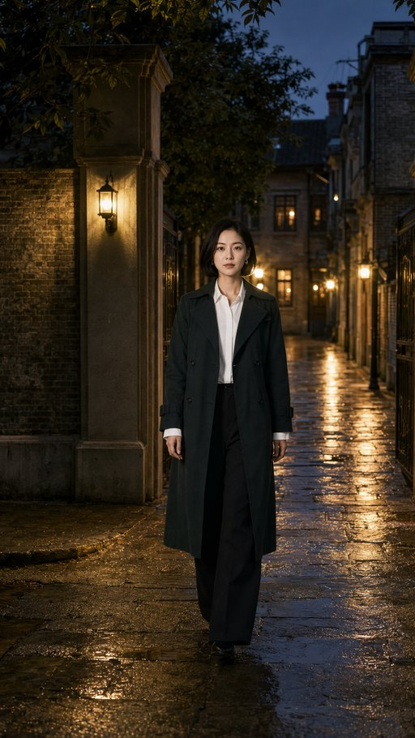

# PicSpec

**把你想要的画面效果写下来一次，之后每个生图模型都照做，每条要求都能核对。**

[English](README.md)

你清楚自己要什么效果：带一点胶片颗粒，人脸要清晰，人物朝左走，绝不要塑料感皮肤。现在你每次都得把这些重新写进提示词，模型还是会漏掉一半。PicSpec 把这些偏好存进一个文件 `PICSPEC.md`，每条偏好都是一条能用“是或否”核对的规则。出图时它按每个模型最容易理解的方式把规则加进提示词，商业模型（gpt-image-2）和本地模型（ComfyUI）都支持。全程不训练、不微调任何模型。

```markdown
# 我的出图规格

自然光纪实人像，35mm 胶片质感。

## 画面质感
- `t1` 全画面带轻微的胶片颗粒，没有数码的平滑感
  - 核对：画面里是否能看到均匀的细颗粒？
- `t2` 人物面部清晰，眼睛对焦准确
  - 核对：人物的眼睛和面部是否清晰锐利、没有发糊？
  - 适用：画面中有人物

## 主体与构图
- `c1` 人物面向或走向画面左侧
  - 核对：人物是否面向或走向画面左侧？
  - 参考图：refs/pose-left.jpg | 身体朝向参考这张

## 禁忌
- `f1` 过度磨皮、塑料感的皮肤
  - 核对：皮肤是否显得过度磨皮或有塑料感？
  - 期望：否
```

> **状态：v0.7，早期版本。** 现在可用的有：规格文件格式、gpt-image-2 和 ComfyUI 两个适配器、用视觉模型逐条核对成品图、通过编辑最好的那张图来修复没做到的规则。“从你的意见里学规则”是接下来要做的，见[路线图](#路线图)。

## 图集

下面是实测中的真实输出：同一个提示词不带规格、带默认规格、以及用代码修复之后。数字是工具核对出的达成规则数。

| 提示词 | 裸提示词 | 带规格 | 修复后 |
| --- | --- | --- | --- |
| 雨后的小巷里，一个撑着伞的女人 | <br>2/6 | <br>4/7 | <br>6/7 |
| 地铁站台上等车的上班族 | <br>1/7 | <br>4/7 | <br>6/7 |
| 修自行车的中年师傅 | <br>2/7 | <br>5/7 | <br>6/7 |

一部短剧：先出角色定妆图和场景图，再以它们为参考出两张分镜关键帧。

| 角色定妆图 | 场景图 | 分镜 1 | 分镜 2 |
| --- | --- | --- | --- |
|  |  |  |  |

## 实测结果

**十个提示词，裸提示词对比带规格。** 十个不同的人物场景（咖啡馆、厨房、地铁、花店、雪地、图书馆、夜市、山顶、海边、篮球场），每种各出一张，默认的 7 条规则，gpt-image-2 中等质量，只出一轮、不做修复，由 a vision model 核对。

| 规则 | 裸提示词 | 带规格 |
| --- | --- | --- |
| 胶片颗粒 | 0/10 | 10/10 |
| 面部清晰 | 8/10 | 10/10 |
| 侧逆光（尽量） | 2/10 | 2/10 |
| 面向左侧 | 5/10 | 10/10 |
| 腰部以上的中景 | 2/10 | 5/10 |
| 没有塑料感皮肤 | 10/10 | 10/10 |
| 没有文字或标志 | 3/10 | 9/10 |
| **全部规则** | **30/70（43%）** | **56/70（80%）** |

十个提示词里，带规格的图满足的规则都比裸提示词多。看这张表要结合判官的可靠度：颗粒、朝向、文字是判官验证过的规则，这几行的提升是可信的；塑料感皮肤那一行不能算成绩，因为判官看不出这个问题。光向完全没有变化，景别只改善了一半，所以景别现在改用裁切来修。每个提示词每种条件只有一张图，一个模型，一个判官。

### 最初的单提示词测试

同一个提示词跑了两次，所以这只能说明流程跑通了，不能当评测结果看。使用模板规格（7 条规则），gpt-image-2 出 1024x1536 的图，提示词是“雨后的小巷里，一位撑伞的年轻女子”。

| 轮次 | 图片 | 做到的规则 | 没做到的 |
| --- | --- | --- | --- |
| 1（the first judge model 核对） | 只用原始提示词 | 7 条中 3 条 | 胶片颗粒、腰部以上中景、画面无文字、侧逆光 |
| 1 | 加上规格 | 7 条中 6 条 | 腰部以上中景 |
| 1 | 强调景别后重新出图 | 7 条中 5 条 | 腰部以上中景、侧逆光 |
| 2（a vision model 核对） | 只用原始提示词 | 7 条中 2 条 | 胶片颗粒、朝向左侧、腰部以上中景、画面无文字、侧逆光 |
| 2 | 加上规格 | 7 条中 5 条 | 腰部以上中景、侧逆光 |
| 2 | 编辑上面那张图 | 7 条中 4 条 | 胶片颗粒、腰部以上中景、侧逆光 |
| 2 | 强调两条后重新出图 | 7 条中 6 条 | 腰部以上中景 |

目前能看出的：

- 加上规格后，做到的规则从 2 到 3 条提高到 5 到 6 条。
- “腰部以上中景”这条在全部 7 张图里都没做到，不管是强调还是编辑。对这个模型，光靠提示词的说法改不动它。
- 唯一一次编辑修复反而更差：要求同时修两条并保持其余不变，结果两条都没修好，还丢了颗粒、改了色调。下一步要试的是一次只修一条，以及景别类规则直接裁切。
- 判官之间比较一致：对第 1 次的三张图，a vision model 和 the first judge model 的 21 条判定有 20 条相同；两次的对照图和最好的图，人工看图的结论和判官一致。改为逐条提问时又有一条判定翻转，是皮肤质感那条。
- 每张图连同核对用时 45 到 65 秒。ComfyUI 适配器还没有对真实的服务跑过。

## 安装

```bash
git clone https://github.com/xcanhu/PicSpec && cd PicSpec
pip install -e .
```

需要 Python 3.10 或更新版本，唯一的依赖是 Pillow。

## 快速开始

```bash
picspec init --lang zh             # 生成一份中文的 PICSPEC.md 模板
picspec lint                       # 列出所有规则，报告文件里的错误
picspec compile "雨后的小巷里，一位撑伞的年轻女子"     # 只显示将要发给模型的内容，不调用任何接口

export OPENAI_API_KEY=sk-...       # Windows 命令行用 set OPENAI_API_KEY=sk-...
picspec generate "雨后的小巷里，一位撑伞的年轻女子" --baseline -n 2
```

`generate` 会把图片和一份 `run.json` 记录写到 `picspec-out/<时间>/`。加上 `--baseline` 会用原始提示词再出一张，方便左右对比。

想让每条规则都被核对，指定一个视觉模型，再加上 `--check`：

```bash
export PICSPEC_JUDGE_MODEL=你的视觉模型       # 任何能看图、兼容 OpenAI 对话接口的模型
picspec generate "雨后的小巷里，一位撑伞的年轻女子" --check --baseline
picspec check photo.png                      # 核对一张已有的图
```

| 命令 | 作用 |
| --- | --- |
| `picspec init [路径] [--template 名称]` | 生成 `PICSPEC.md` 模板 |
| `picspec rules [规则名 ...]` | 浏览规则库，或把规则打印出来粘贴进规格文件 |
| `picspec lint [规格文件]` | 列出每条规则和它的核对问题，按行号报告错误 |
| `picspec fmt [规格文件]` | 把文件整理成标准排版，并给每条规则补上编号 |
| `picspec compile "提示词"` | 显示某个后端实际会收到的提示词、反向提示词和参考图 |
| `picspec generate "提示词"` | 按规格出图 |
| `picspec generate "提示词" --check` | 出图后逐条核对，并修复没做到的规则 |
| `picspec check 图片` | 逐条核对已有的图片 |
| `picspec learn "反馈"` | 把一句反馈变成一条规则改动建议 |
| `picspec bench prompts.txt` | 用一批提示词对比裸提示词和带规格，给出每条规则的达成率 |
| `picspec mcp` | 作为 MCP 服务运行，供编程智能体使用 |
| `picspec faces a.png b.png` | 找出人脸并两两比对（需要人脸工具） |
| `picspec audit 图片 --probe ...` | 检验判官：把图片做已知的改动，看它的回答是否跟着变 |

`compile` 和 `generate` 可以用 `--only t1,c1`、`--skip f2` 选择规则，用 `--size 1536x1024`、`--quality high` 调整尺寸和质量，用 `--spec 文件` 指定规格文件。不指定时使用当前文件夹或最近的上级文件夹里的 `PICSPEC.md`，所以一份规格可以管一整个项目。

## 规则库与起步规格

不同的人对生成图的要求不一样，所以 PicSpec 自带一个规则库，按用户最常提出和抱怨的方面分组：

| 类别 | 例子 | 规则数 |
| --- | --- | --- |
| 真实感与质感 | 皮肤毛孔、胶片颗粒、不要塑料皮肤、不要过度饱和 | 7 |
| 表情与神态 | 表情自然、眼中有高光、不要摆拍式笑容 | 6 |
| 结构与细节缺陷 | 手、肢体、变形的物体、错乱的建筑 | 7 |
| 画面文字 | 不要文字、不要叠加的说明文字、文字可读 | 3 |
| 光线、构图与镜头 | 面部清晰、景别、朝向、纯净背景 | 18 |
| 风格与色调 | 写实照片、扁平插画、有限配色、不要渲染感 | 7 |
| 与参考图保持一致 | 同一张脸、同一套服装、同一个场景、同一种画风 | 5 |

```bash
picspec rules --lang zh                # 列出全部
picspec rules --category expression    # 只看一类
picspec rules skin-texture bad-hands   # 把这几条按规格文件的写法打印出来，直接粘贴
```

每条规则都如实标注了“让视觉模型来核对它有多可信”：**判官已验证**（实测审计里判官的回答跟着合成改动变了，目前 6 条）、**判官不可靠**（测试没通过：塑料感皮肤、皮肤纹理、同一张脸）、**未测**（其余全部）。未测的规则照样会写进提示词，但它的核对结果在审计之前只能当参考。

`picspec init --template 名称` 用规则库生成一份起步规格：

| 模板 | 用途 |
| --- | --- |
| `starter`（默认） | 胶片感纪实人像，也就是本页开头的例子 |
| `portrait` | 写实人像：皮肤纹理、表情自然、不要美化过的五官 |
| `product` | 电商产品图：产品完整入画、背景纯净、不偏色 |
| `illustration` | 扁平插画：有限配色、线条干净、不要照片式明暗 |
| `drama-character` | AI 短剧角色定妆图：单个角色、全身、自然站立、纯净背景 |
| `drama-scene` | AI 短剧场景或建筑：无人的大全景、线条横平竖直、结构不错乱 |
| `drama-shot` | AI 短剧分镜关键帧（9:16 竖屏）：脸、服装、场景、光线和画风必须与你的参考图一致 |

### 跨图一致性

带 `参考图` 的规则会拿参考图来核对：判官会同时收到成品图和参考图，所以“人物的脸和参考图里的是否是同一个人？”这样的问题可以直接问。`drama-shot` 模板需要规格文件旁边有 `refs/character.png` 和 `refs/scene.png`，它们先用另外两个短剧模板做出来。镜头之间“崩脸”是 AI 短剧制作教程里提到最多的问题。这类对比规则是新加的。第一次 7 对图的小测试里，确实相同的图对判官全部答对，但 3 对不同的生成人脸全被它判成同一个人，所以 `same-face` 判“通过”时要谨慎对待。装上[人脸工具](#人脸工具可选)后，这条规则改由人脸比对模型来判。

## 人脸工具（可选）

视觉模型在人像上做不好的两件事，装上人脸工具后改用测量：

```bash
pip install -e ".[face]"     # 安装 OpenCV；第一次使用时下载两个小模型
picspec faces a.png b.png    # 找出人脸，并给出每两张图的相似度
```

- **皮肤和表情。** 1024x1536 的图里脸太小，判官看不到毛孔：不管有没有磨皮，它在所有测试图上都答“看不到皮肤纹理”。装上人脸工具后，只要脸的高度不到图高的 40%，判官还会收到一张原始分辨率的脸部放大图。
- **是不是同一个人。** 带 `测量：face-match` 和参考图的规则由人脸比对模型来判（SFace 特征的余弦相似度），不再问判官。默认要求分数达到 0.6，可以用 `测量：face-match >= 0.5` 自己定。给规则写多行 `参考图`（正面、四分之三侧面、侧面），取最接近的那张来算。脸转得太偏、无法比对时，这条规则按“不适用”处理。

第一次实测（7 张生成人像，脸占图高的 7% 到 17%）：

| 问题 | 结果 |
| --- | --- |
| SFace 公布的阈值 0.363 能分开生成的人脸吗 | 不能。20 对互不相关的生成人像里有 15 对达到 0.363，得分范围是 0.22 到 0.61 |
| 调高阈值呢 | 基本可以。同一张脸轻度改动（镜像、裁切、轻微模糊、轻颗粒、磨皮）后的 63 对里，62 对高于 0.62。重度模糊或颗粒会把同一张脸压到 0.30，所以没有完美的阈值 |
| 放大图对“能否看到毛孔”有帮助吗 | 有。没有放大图时 7 张原图通过 0 张；有放大图时通过 4 张，它们磨皮后的版本大多不通过 |
| 对“皮肤是否有塑料感”有帮助吗 | 很小。判官仍然漏掉大部分磨皮的脸，而且两次回答不一致 |

所以 PicSpec 用 0.6。这个数只来自一小批图，请当作起点；它对转头的镜头偏严（见下面的短剧实测）。

不装人脸工具时其余功能照常：带测量的规则会退回给判官，命令会提示这一点。设置 `PICSPEC_FACE=off` 可以关闭；机器不能联网时，把模型文件放进一个文件夹并用 `PICSPEC_FACE_MODELS` 指向它。

### 一部短剧，从头到尾

用三份短剧模板实测一次：先出角色定妆图和场景图，再以它们为参考图出三张 9:16 的分镜关键帧（共 5 次出图请求，高质量下每张约两分钟）。

| 分镜 | 通过的规则 | 与定妆图的人脸相似度 | 看图的结论 |
| --- | --- | --- | --- |
| 她从弄堂口走进来，正面 | 9/9 | 0.75，通过 | 同一个人，同一条弄堂 |
| 她越过肩膀回头看 | 8/9 | 0.54，不通过 | 同一个人，同一条弄堂：工具判错了 |
| 从侧后方看，她停在门前 | 7/9 | 0.29，不通过 | 发型和风衣一致，脸几乎看不到 |

gpt-image-2 在三张图里都保持住了角色、服装、弄堂和画风，判官在服装、地点、画风和光线上的判定也都对。弱的是人脸比对：它对转了四分之三的头偏严，还给一线本不该比对的侧脸打了分。这次实测之后，侧脸会让这条规则按“不适用”处理，规则也可以带多个角度的参考图；这两处改动还没有在真实图片上试过。

## 用测量来判的规则和代码修复

不是所有事都适合问视觉模型。带 `测量` 字段的规则改由测量来判，不花钱，每次结果都一样：

| 测量 | 量的是什么 | 例子 | 需要 |
| --- | --- | --- | --- |
| `grain` | 画面平坦区域的细小噪点强度，0 到 255。约 3 是放大才看得出的淡颗粒，5 是细看能看出，10 是一眼可见 | `测量：grain >= 3` | 无 |
| `face-share` | 主要人脸的高度占图高的比例，也就是景别：约 0.06 到 0.13 是全身，0.16 到 0.32 是腰部以上 | `测量：face-share 0.16..0.32` | 人脸工具 |
| `face-match` | 人脸与这条规则的参考图的相似度 | `测量：face-match >= 0.6` | 人脸工具 |

其中两种还能**用代码修复**，发生在花钱编辑或重新出图之前。脸相对景别规则太小时，围绕人脸裁切再放大回原尺寸（最多放大 2 倍）；缺颗粒时直接加上。修复后的图和其他图一样重新核对，在输出里显示为 `fixed in code from round1-1.png`。这个功能就是为景别做的：在我们的测试里，不管提示词怎么写，gpt-image-2 遵守“腰部以上”的图不到一半。

在 4 张景别或颗粒不合格的真实图片上，3 张被裁切（放大 1.3 到 1.7 倍）并补了颗粒，结果是合理的腰部以上构图，清晰度可以接受；第 4 张需要放大超过 2 倍，按设计没有裁切。这些阈值能信到什么程度：颗粒强度取 2.6 时与判官在 42 张审计图上完全一致，但在 20 张新图上有 8 张不一致，因为 2 到 3 之间的差别在正常大小下人眼分不出来。脸部占比低于 0.15 时判官每次都判“拍得太远”，0.15 到 0.20 之间判官自己也是一半一半，最初的默认值 0.22 后来发现偏严：它把一张 0.17、本来就是很好的腰部以上的图又裁紧了一圈。现在默认从 0.16 起，裁切的目标是 0.20。两个默认值都只建立在几十张图上。

## 核对与重试

加上 `--check` 后，每张成品图会连同所用规则的核对问题一起发给视觉模型。对每条规则，模型先说出它看到了什么，再回答是或否；规则的“适用”条件在这张图里不成立时回答“不适用”。回答和规则的“期望”一致，就算这条规则做到了。

```
picspec-out/20261120-121500/round1-1.png  (picspec: 5/7 rules met, not met: t1, c1)
picspec-out/20261120-121500/round2-1.png  (picspec: 7/7 rules met)

picspec-out/20261120-121500/best.png  (copy of round2-1.png: 7/7 rules met)
```

- 所有适用的“必须”规则都做到，这张图才算通过。“尽量”规则会被报告，重试时也会被强调，但不会让一张图不通过。
- 代码能修的问题（景别、颗粒）先用代码修，不花出图费用。见[用测量来判的规则](#用测量来判的规则和代码修复)。
- 一轮里没有图通过时，下一轮会修复目前最好的那张图：把它送进模型的编辑接口，指令里列出要修的规则，以及哪些已经做到、必须保持。修完后所有规则重新核对一遍，所以修好一条却弄坏另一条的图不会被选中。
- 不支持编辑的后端（目前是 ComfyUI）改为重新出图，并把没做到的规则放到提示词最前面、标为最重要。`--repair regenerate` 强制重新出图，`--repair edit` 始终编辑，默认的 `--repair auto` 先编辑，某一轮编辑没有任何改善时改为重新出图。
- `--rounds N` 设置最多跑几轮（默认 3 轮），`-n K` 设置每轮出几张。某一轮有图通过就停止，`best.png` 是没做到的规则最少的那张。
- `--one-by-one` 改为每条规则单独问一次，而不是每张图问一次。花费更多，但各条回答不会互相影响。
- 图片长边超过 1536 像素时，颗粒、清晰度这类质感规则会额外附上一张画面中心的原始分辨率裁切，因为整张图缩小后这些细节就看不出来了。
- `run.json` 记录每张图、实际发送的提示词，以及每条规则的判定结果和模型看到的内容。

视觉模型用 `--judge 模型名`、环境变量 `PICSPEC_JUDGE_MODEL` 或规格文件设置里的 `judge:` 指定。它的地址和密钥依次取自 `--judge-base-url` 和 `--judge-api-key`、`PICSPEC_JUDGE_BASE_URL` 和 `PICSPEC_JUDGE_API_KEY`、OpenAI 的设置。最好的那张图仍有“必须”规则没做到时，命令的退出码是 1。

花费：核对一张图等于一次生图请求加一次看图请求。三轮、每轮两张，最多各六次。

## 从反馈里学规则

结果不对的时候，把原因说一次，它就变成一条规则：

```bash
picspec learn "皮肤太光滑了，像开了美颜" --image out/best.png
```

```
add    plastic-skin: 抱怨的是过度磨皮的皮肤
add    skin-texture: 要求能看到皮肤细节

+- `skin-texture` 皮肤保留自然纹理，能看到毛孔和细小瑕疵
+  - 核对：皮肤上是否能看到毛孔或细微纹理？
...
确认无误后运行 picspec learn --apply，写入的就是上面这份改动。
```

一个对话模型会读你的规格、规则库和这句反馈，然后提出最小的改动：收紧已有规则、从规则库里加一条、新写一条，或者删掉一条。运行 `picspec learn --apply` 之前不会写任何东西；它写入的就是你看到的那份改动，不会再问一次模型。只和某一张图的内容有关的反馈（“这张让她笑一下”）不会产生规则。用的模型就是核对图片的那个（`--judge`、`PICSPEC_JUDGE_MODEL`）。

## 接入智能体和 ComfyUI

**MCP 服务。** `picspec mcp` 通过标准输入输出提供 Model Context Protocol 服务，编程智能体出图时就能套用你的规格：

```json
{"mcpServers": {"picspec": {"command": "picspec", "args": ["mcp"]}}}
```

它提供 `picspec_rules`、`picspec_compile`（套用规格后的提示词，可以交给智能体手里的任何出图工具）、`picspec_generate`、`picspec_check`、`picspec_learn` 和 `picspec_library`。密钥和模型用的是和命令行相同的环境变量。

**ComfyUI 节点。** 把 [comfyui](comfyui) 文件夹复制到 `ComfyUI/custom_nodes/picspec`，并在 ComfyUI 的 Python 里安装 `picspec`。*PicSpec Prompt* 把一句短提示词和规格文件路径变成正向和反向文本，接到 CLIP Text Encode 节点上。*PicSpec Check* 接收成品图，输出逐条核对报告和是否通过。

## 测一测规格到底改变了什么

一组前后对比图说明不了多少。`picspec bench` 把一批提示词各跑两遍，一遍裸提示词、一遍带规格，逐条核对每张图，然后给出每条规则的达成率：

```bash
picspec bench examples/prompts.zh.txt --quality medium -o bench1             # 每个提示词 2 次出图
picspec bench examples/prompts.zh.txt --quality medium --rounds 2 -o bench2  # 同时给出修复后的结果
```

每跑完一个提示词就保存一次，中断后再运行同一条命令会接着跑。表格在 `bench.md` 里，文件夹里保留每一张图。

一次带修复的实测，6 个提示词，默认规格，中等质量：

| | 裸提示词 | 带规格 | 修复后 |
| --- | --- | --- | --- |
| 全部规则 | 12/41（29%） | 27/42（64%） | 37/42（88%） |
| 所有必须项都满足的图 | 0/6 | 0/6 | 6/6 |

6 次修复全部由代码完成（裁切、加颗粒或两者都有），所以“修复后”这一栏没有花出图请求，整轮一共 12 次。有两点要注意。这里颗粒和景别是用测量判的，阈值比判官严，所以“带规格”一栏看起来比上面十个提示词的表低。另外“修复后”一栏用的是驱动修复的同一批测量来打分，它说明修复达到了测量目标。人看图的结论是三张里同意两张，第三张裁得比需要的更紧，景别的默认值因此放宽了。

## 不用人工标注地审计判官

上面所有结果都建立在“判官判得对”之上，所以 PicSpec 可以检验判官本身。`picspec audit` 用代码把图片改成“正确答案已知”的样子，再问一次判官，统计它的回答有多少次跟着变。

```bash
picspec audit photo1.png photo2.png \
    --probe flip=c1 --probe text=f2 --probe grain=t1 --probe blur=t2 --probe smooth=f1 -o audit-out
```

| 探针 | 对图片做什么 | 指定规则的回答必须怎样 |
| --- | --- | --- |
| `flip` | 水平镜像 | 左右类问题原来答“是”的必须变成“否”，其他规则的回答必须不变 |
| `text` | 画上一行文字 | 变成“是” |
| `grain` | 加三档强度的噪点 | 最强一档变成“是”，较弱的两档能看出判官从哪里开始察觉 |
| `blur` | 三档强度的模糊 | 最强一档变成“否” |
| `smooth` | 抹平细小纹理 | 变成“是” |

规则的问题方向相反时写成 `--probe smooth=t1:no`（抹平后“是否有颗粒”必须变成否）。每张原图还会被问两次，用来测判官自相矛盾的比例。输出里每个探针和规则一行，比如 `grain t1 6/7 correct`；加 `-o` 会保存改动后的图片和全部回答。这些探针检验的是判官能不能看出某个属性，不是人会不会喜欢这张图；目前还不覆盖景别和光向。

第一次实测审计（7 张生成图，84 次看图请求，一个判官模型）：

| 探针 | 规则 | 结果 |
| --- | --- | --- |
| `flip` | 面向左侧 | 6/6 正确（第七张原本就不是“是”，没有可翻转的答案） |
| `text` | 无文字 | 7/7 |
| `grain` | 可见颗粒 | 三档全部 7/7，包括人要放大才看得出的最弱一档 |
| `blur` | 面部清晰 | 三档全部 7/7 |
| `smooth` | 颗粒消失 | 7/7 |
| `smooth` | 塑料感皮肤 | 弱档 2/7，强档 5/7 |

同一张原图问两次，49 个回答里 48 个不变。镜像之后，不该受方向影响的规则 42 个回答里 37 个不变。两点教训：判官说“看得到颗粒”的门槛比人在正常大小下能察觉的更低；`smooth` 探针不适合检验“过度磨皮”，因为它把整张图都抹糊了，而不是只抹皮肤，判官答“否”往往说得通。

## 后端

| 后端 | 怎么选 | 参考图 | 反向提示词 | 种子 |
| --- | --- | --- | --- | --- |
| gpt-image-2（默认） | `--backend gpt-image-2` | 最多 16 张 | 不支持 | 不支持 |
| 任何兼容 OpenAI 图片接口的模型 | `--backend 模型名 --base-url 地址` | 最多 16 张 | 不支持 | 不支持 |
| ComfyUI（本地） | `--workflow workflow_api.json` | 暂不支持 | 工作流里有 `%negative%` 时支持 | 工作流里有 `%seed%` 时支持 |
| mock | `--backend mock` | 4 张 | 支持 | 支持 |

**gpt-image-2。** 密钥来自 `--api-key`、`PICSPEC_OPENAI_API_KEY` 或 `OPENAI_API_KEY`；地址来自 `--base-url`、`PICSPEC_OPENAI_BASE_URL` 或 `OPENAI_BASE_URL`，所以中转网关也能用。用到的规则带参考图时，请求会走编辑接口并附上图片，提示词里会写明每张图只参考哪一方面。尺寸在发送前先检查：宽高都能被 16 整除，宽高比在 1:3 到 3:1 之间，最大 3840x2160。

**ComfyUI。** 启动 ComfyUI，用“Save (API Format)”导出工作流，在对应位置填上占位符 `%prompt%`，以及可选的 `%negative%`、`%seed%`、`%width%`、`%height%`。[examples/comfyui](examples/comfyui) 里有 8GB 显卡能跑的 Qwen-Image GGUF 工作流。地址默认是 `http://127.0.0.1:8188`，可以用 `--base-url` 或 `PICSPEC_COMFYUI_URL` 修改。发给本地模型的规则会合并成一段普通的描述，因为它们的文本编码器读整段话比读列表更好。示例里的两个工作流为了提速把 CFG 设成了 1，这种设置下反向提示词不起作用。

**mock** 只画一张纯色图，用来在没有密钥和显卡的情况下试用各个命令。

## PICSPEC.md 的格式

规格文件就是普通的 Markdown，在 GitHub 上能直接阅读，手工编辑也方便。

- **设置**（可选）写在文件开头的两行 `---` 之间：`size`、`quality`、`backend`、`judge`、`lang`（`zh` 或 `en`）。
- **标题下面的那段话**是整体风格，每次出图都会带上。
- **每个 `##` 小节**是一组规则，小节标题决定规则的类型：标题里有“质感、画质、光、色”的是画面质感；有“主体、构图、姿态、动作”的是主体与构图；有“禁忌、禁止、不要、避免”的是禁忌。其他标题是普通小节。
- **每个一级列表项是一条规则。** 开头反引号里的是规则编号，可以不写，`picspec fmt` 会自动补上。
- **缩进的列表项是这条规则的字段：**

| 字段 | 含义 | 不写时 |
| --- | --- | --- |
| `核对` (`check`) | 针对成品图的一个是非题，用来判断这条规则有没有做到 | 用规则原文生成一个通用问题 |
| `期望` (`expect`) | 哪个回答算“做到了”：`是` 或 `否` | `是` |
| `级别` (`level`) | `必须`，或者 `尽量`（锦上添花的规则） | `必须` |
| `适用` (`when`) | 规则在什么情况下适用，比如“画面中有人物” | 总是适用 |
| `提示词` (`prompt`) | 发给模型时用的说法，代替规则原文 | 用规则原文 |
| `反向` (`negative`) | 写进反向提示词的词，只对支持反向提示词的后端有效 | 无 |
| `测量` (`measure`) | 让工具而不是判官来判这条规则。目前有 `face-match`，可以写成 `face-match >= 0.5` | 无 |
| `参考图` (`ref`) | 一张参考图，写成 `路径 \| 参考它的哪一方面`。多张图就写多行 | 无 |
| `类型` (`kind`) | 不按标题、单独指定类型：`质感`、`构图`、`禁忌`、`其他` | 按标题 |

禁忌小节里的规则直接写不想要的东西本身（比如“文字、水印或标志”），核对问题问“是否出现”，期望填“否”。写反了 `picspec lint` 会提醒。

字段名中英文都可以用，冒号全角半角都可以。注释、引用和代码块会原样保留，不会被当成规则。完整的示例见 [examples](examples)。

## 在 Python 里使用

```python
from picspec import load, build_request
from picspec.backends import make_backend

spec = load("PICSPEC.md")
request = build_request(spec, "雨后的小巷里，一位撑伞的年轻女子")
backend = make_backend("gpt-image-2")
print(backend.render(request).prompt)      # 将要发送的内容
result = backend.generate(request)
result.image.save("out.png")
```

一个后端就是一个很小的类：声明自己支持什么（参考图、反向提示词、种子），在 `render` 里把请求翻译成自己模型习惯的说法，在 `_run` 里出图。见 [src/picspec/backends](src/picspec/backends)。

## 路线图

1. **规格文件与适配器。** 已完成。
2. **逐条核对与定向修复。** 已完成，包括用测量来判的规则和代码修复。
3. **从反馈学规则。** 已完成：`picspec learn`。
4. **更多用法。** 已完成：MCP 服务和 ComfyUI 节点。还没做：本地模型的参考图，以及 ComfyUI 适配器和节点的真实运行。
5. **评测基准。** 工具已完成（`picspec bench`）。还没做：跨模型、跨规则类别的大规模评测，以及在皮肤和表情上可信的判官。

## 许可

Apache-2.0
